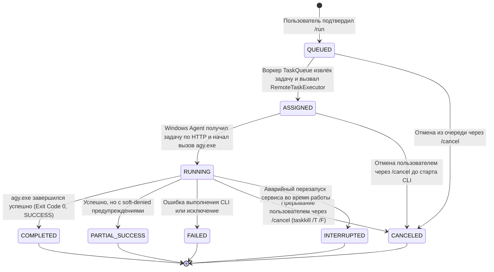

# Архитектурный анализ и дизайн системы (docs/ARCHITECTURE.md)

В данном документе проводится сравнительный анализ архитектурных вариантов системы **Telegram Remote Control**, описывается физика и ограничения технологии Wake-on-LAN, формулируются зоны ответственности компонентов, возможные точки отказа и перечень открытых вопросов по интеграции с Antigravity CLI.

---

## 1. Сравнительный анализ архитектурных вариантов

Для реализации системы рассматриваются две принципиальные схемы размещения компонентов.

### Вариант A. Монолитная схема (Telegram-бот и исполнитель на Целевом ПК)

Вся функциональность (Telegram-бот, парсер команд, планировщик задач и модуль взаимодействия с Antigravity CLI) выполняется в виде единого процесса (или службы) непосредственно на целевом Windows-компьютере.

```
┌────────────────────────────────────────────────────────┐
│                   Целевой Windows-ПК                  │
│                                                        │
│  [Пользователь] ──> [Telegram API] ──> [Telegram Bot] │
│                                              │         │
│                                              ▼         │
│                                     [Antigravity CLI]  │
└────────────────────────────────────────────────────────┘
```

* **Преимущества**:
  * Максимальная простота развёртывания: не требуется дополнительное физическое оборудование или виртуальные серверы.
  * Прямой доступ к локальной файловой системе и окружению Windows без сетевых протоколов взаимодействия между сервисами.
  * Единая кодовая база и локальная отладка.
* **Критические ограничения**:
  * **Невозможность удалённого включения (Wake-on-LAN)**: Когда Windows-компьютер выключен или находится в режиме сна/гибернации, процесс бота физически остановлен и не подключён к Telegram API. Пользователь не может отправить боту команду `/wake`, а выключенный компьютер не может отправить сетевой пакет самому себе.
  * **Ложные сбои связи**: При зависании или перезагрузке Windows пользователь теряет какой-либо фидбек в Telegram (бот просто перестаёт отвечать без объяснения причин).
* **Применимость**: Подходит исключительно для сценария, когда ПК включён 24/7, что прямо противоречит цели экономии энергии и использованию Wake-on-LAN.

---

### Вариант B. Распределённая схема (Постоянный Контроллер + Windows Agent) — [ВЫБРАННОЕ РЕШЕНИЕ]

Система разделяется на два независимых логических компонента:
1. **Контроллер (Controller)**: Легковесный сервис, запущенный на постоянном узле (управление очередью задач, интерфейс Telegram-бота, отправка сигналов Wake-on-LAN).
2. **Windows Agent**: Фоновый сервис на целевом компьютере, запускаемый в контексте пользовательской учётной записи Windows, взаимодействующий с Контроллером и непосредственно управляющий Antigravity CLI.

```
┌─────────────────────────────────┐                ┌───────────────────────────────┐
│     Постоянно доступный узел    │                │      Целевой Windows-ПК       │
│      (Controller Service)       │                │                               │
│                                 │  (WoL UDP:9)   │     [Сетевая карта (NIC)]     │
│ [Пользователь] ──> [Telegram]   │ ──────────────>│               │               │
│                         │       │  (L2 Broadcast)│               ▼ (Boot)        │
│                         ▼       │                │        [Windows Agent]        │
│                 [Task Queue/DB] │ <────────────> │  (Запуск от имени User)       │
│                                 │ (Heartbeat /   │               │               │
│                                 │  Tasks sync)   │               ▼               │
│                                 │                │     [Antigravity CLI (agy)]   │
└─────────────────────────────────┘                └───────────────────────────────┘
```

#### Принципы реализации и независимость от физического устройства:
* **Агностичность к устройству (Device-agnostic)**: Архитектура не привязывается жестко к конкретной аппаратной платформе Контроллера. В роли хоста для Контроллера может выступать домашний сервер/NAS, одноплатный ПК (Raspberry Pi), мини-ПК или домашний роутер с поддержкой исполнения сценариев.
* **Режим разработки (Development)**: На этапе разработки допускается локальный запуск обоих логических компонентов (и Контроллера, и Windows Agent) на одном включённом целевом Windows-компьютере. Это упрощает отладку взаимодействия, не требуя развёртывания вторичных устройств.
* **Режим промышленной эксплуатации (Production)**: Для обеспечения удалённого включения через Wake-on-LAN Контроллер (или выделенный WoL-узел) обязан оставаться постоянно включённым и сетевым образом доступным, когда целевой ПК обесточен.
* **Сетевая реальность внешнего VPS**:
  > [!WARNING]
  > Обычный публичный виртуальный сервер (VPS) **не способен напрямую** отправить широковещательный Magic Packet в домашний L2-сегмент сети.
  > Направленные широковещательные рассылки (Directed Broadcast) через Интернет блокируются 99% провайдеров и потребительских маршрутизаторов.
  > При размещении Контроллера на внешнем VPS обязательным условием является наличие защищённого туннеля (VPN на базе WireGuard / Tailscale) и сетевого узла-посредника (шлюза/агента) внутри домашней локальной сети, который транслирует команду включения в локальный broadcast.

---

## 2. Физика и специфика Wake-on-LAN (WoL)

### 2.1. Принцип работы
Технология Wake-on-LAN основана на мониторинге физического сетевого интерфейса (NIC). Когда компьютер выключен (состояние ACPI `S5` / Soft Off) или находится в режимах сна/гибернации (`S3`/`S4`), сетевой контроллер запитывается дежурным напряжением (+5VSB) и сканирует входящие кадры на наличие **Magic Packet** (6 байтов `0xFF` + 16 повторений 48-битного MAC-адреса).

### 2.2. Разделение событий: отправка пакета vs фактическое пробуждение
> [!IMPORTANT]
> **Принципиальное проектное разграничение**:
> Успешная отправка Magic Packet сетевым сокетом Контроллера и фактическое физическое включение целевого ПК — это **два принципиально разных события**.

1. Успешный вызов функции отправки пакета подтверждает только то, что UDP-датаграмма была сформирована и отдана сетевому стеку Контроллера.
2. Пробуждение компьютера зависит от физической среды: кабельного подключения, состояния линии, настроек BIOS/UEFI, опций Windows Fast Startup и фильтрации broadcast-трафика роутером.
3. **Открытый вопрос архитектуры**: Проверку реального включения компьютера невозможно верифицировать только программными модульными тестами. Окончательное подтверждение требует практической проверки на реальном «железе» целевой рабочей станции. До подтверждения от Windows Agent статус хоста считается не `Online`, а `Waking Up (Pending Heartbeat)`.

---

## 3. Компоненты, зоны ответственности и точки отказа

| Компонент | Зона ответственности | Взаимодействие | Возможные точки отказа и реакция |
| :--- | :--- | :--- | :--- |
| Компонент | Зона ответственности | Взаимодействие | Возможные точки отказа и реакция |
| :--- | :--- | :--- | :--- |
| **Telegram Gateway** | Приём команд (`/start`, `/help`, `/status`, `/wake`, `/workspace`, `/run`, `/tasks`, `/cancel`, `/result`), строгая валидация `user_id` по allowlist (stealth-режим для неизвестных), генерация Inline-диалогов подтверждения. | Входящие сообщения Telegram, передача проверенных команд в Task Dispatcher / TaskStore. | *Точка отказа:* Сбой сети, блокировки API, rate-limits (HTTP 429).<br>*Реакция:* Экспоненциальный retry, stealth-отбрасывание чужих апдейтов. |
| **Task Dispatcher / TaskStore** | Долговременная очередь задач в SQLite (`data/tasks.sqlite3`), строго последовательное исполнение (concurrency = 1), Crash Recovery (`recover_on_startup`), хранение результатов в `data/results/`. | Telegram Gateway, фоновый воркер `TaskQueue`, адаптер `AgyClient`. | *Точка отказа:* Перезапуск службы, сбой БД, параллельный запуск.<br>*Реакция:* Защита `SingleInstanceLock`, маркировка `RUNNING` как `INTERRUPTED`, сохранение `QUEUED`. |
| **SingleInstanceLock** | Блокировка на уровне дескриптора файла ОС (`.instance.lock`) через `msvcrt.locking` / `fcntl.flock` для предотвращения конкурентного доступа к БД и Telegram Long Polling. | Захват при старте в `main.py`, освобождение при выходе. | *Точка отказа:* Повторный запуск службы при уже активном процессе.<br>*Реакция:* Немедленный отказ с кодом возврата 1 и записью в лог. |
| **WoL Module** | Формирование стандартизированного пакета (6x 0xFF + 16x MAC), отправка в сконфигурированный broadcast-интерфейс LAN. | Вызывается Контроллером при подтверждении `/wake`. | *Точка отказа:* Ошибочный MAC, изоляция broadcast-сегмента.<br>*Реакция:* Валидация формата MAC-адреса, логирование сетевой ошибки сокета. |
| **Windows Agent** | Запуск под учётной записью пользователя Windows, проверка директорий по белому списку `ALLOWED_WORKSPACES`, исполнение Antigravity CLI, перехват потоков, сбор диагностических сообщений, принудительная отмена. | Связь с Контроллером (WebSocket/Long polling), запуск подпроцессов Windows. | *Точка отказа:* Зависание подпроцесса CLI, истечение таймаута.<br>*Реакция:* Завершение дерева процессов (`taskkill /T /F` / Job Object), отчёт об ошибке Контроллеру. |
| **Antigravity CLI (`agy`)** | Выполнение инженерных задач в пакетном non-interactive режиме. | Вызывается Windows Agent с аргументами `-p ... --output-format json`. | *Точка отказа:* Отсутствие токена в Credential Manager, soft-denied инструментов.<br>*Реакция:* Разбор JSON-статуса и `stderr`, информирование пользователя. |

---

### 3.1. Архитектура очереди задач и персистентности (Этап 5)

```
[Пользователь] ──> [/run] ──> [FSM Wizard] ──> [Confirmation: "Да, запустить"]
                                                       │
                                                       ▼
                                            [TaskStore (SQLite)]
                                         (INSERT task, status=QUEUED)
                                                       │
                                              asyncio.Event notify
                                                       ▼
                                             [TaskQueue Worker]
                                         (Strict concurrency <= 1)
                                                       │
                                ┌──────────────────────┴──────────────────────┐
                                ▼                                             ▼
                     [UPDATE status=RUNNING]                        [UPDATE status=RUNNING]
                     [Telegram: "▶️ Начато"]                       [AgyClient.execute()]
                                │                                             │
                                └──────────────────────┬──────────────────────┘
                                                       ▼
                                           [Завершение AgyClient]
                                                       │
                           ┌───────────────────────────┴───────────────────────────┐
                           ▼                                                       ▼
                 (Вывод <= 3000 симв.)                                    (Вывод > 3000 симв.)
                 [result_text в SQLite]                                  [data/results/*.txt]
                 [Telegram: сообщение]                                   [Telegram: документ]
                                                       │
                                                       ▼
                                            [UPDATE status=TERMINAL]
```

1. **SQLite Storage (`TaskStore`)**:
   * База данных SQLite расположена по пути `data/tasks.sqlite3` (настраивается через `SQLITE_DATABASE_PATH`).
   * Включён WAL-режим (`PRAGMA journal_mode=WAL`) и таймаут блокировки (`PRAGMA busy_timeout=5000`), инициализируемые однократно при открытии хранилища.
   * **Управление соединениями**: Исключены утечки дескрипторов соединений благодаря менеджеру контекста `_connection()`, который гарантирует вызов `conn.close()` в блоке `finally`.
   * **Схема v2 и миграции**: Управление схемой осуществляется через `PRAGMA user_version = 2`. При миграции с версии 1 удаляются избыточные индексы `idx_tasks_operation_id` и `idx_tasks_status` и создаётся составной индекс `idx_tasks_status_id ON tasks(status, id ASC)`, гарантирующий выборку следующей задачи в порядке FIFO без сканирования таблицы.
   * **Ограничение размера очереди**: Конфигурационный параметр `max_queue_size` (по умолчанию 50, диапазон 1–1000) защищает базу данных от переполнения и DoS-атак. При превышении выбрасывается `QueueFullError`.
   * Защита от двойного клика в Telegram обеспечена ограничением `UNIQUE(confirmation_id)`.
2. **Фоновый исполнитель (`TaskQueue`)**:
   * Работает как долгоживущая фоновая корутина `asyncio.Task`, запущенная в `main.py`.
   * Реактивное ожидание через `asyncio.Event` исключает нагрузку на CPU (sleep polling).
   * **Устранение состояния гонки (Lost Wakeup)**: Сигнал `_work_available.clear()` сбрасывается *до* обращения к очереди `get_next_queued_task()`, что предотвращает потерю уведомлений о задачах, добавленных во время активного цикла воркера.
   * **Неблокирующий запуск CLI**: Отправка уведомления «▶️ Задача запущена» в Telegram делегируется в фоновую `asyncio.Task`, поэтому процесс CLI стартует мгновенно, не дожидаясь ответа от серверов Telegram.
   * Гарантирует строго последовательное исполнение (concurrency = 1) в порядке FIFO.
3. **Безопасность перезапусков и Crash Recovery**:
   * При старте приложения метод `recover_on_startup()` переводит зависшие задачи со статусом `RUNNING` в терминальный статус `INTERRUPTED` с диагностическим комментарием.
   * Задачи со статусом `QUEUED` остаются в очереди и начинают последовательно исполняться.
4. **Защита от параллельного запуска (`SingleInstanceLock`)**:
   * Блокировка файла `.instance.lock` средствами уровня ОС (`msvcrt.locking` на Windows / `fcntl.flock` на Unix).
   * Гарантирует запуск ровно одного процесса, управляющего Telegram Long Polling и очередью SQLite.

---

### 3.2. Контракт взаимодействия Controller и Windows Agent

В рамках подготовки к распределённому режиму зафиксированы типизированные контракты данных и модель аутентификации:

#### 1. Модели данных контракта (`TaskRequest` и `TaskResult`)
```python
class TaskRequest(BaseModel):
    task_id: int
    working_directory: str
    prompt: str
    effort: str = "medium"
    timeout_seconds: float = 300.0
    auto_approve_permissions: bool = False
    conversation_id: str | None = None
    continue_session: bool = False

class TaskResult(BaseModel):
    exit_code: int
    status: str  # SUCCESS, PARTIAL_SUCCESS, ERROR, CANCELED, INTERRUPTED
    response_text: str
    raw_stdout: str
    raw_stderr: str
    duration_seconds: float
    conversation_id: str | None = None
    warning_message: str | None = None
    error_message: str | None = None
```

#### 2. Режимы развёртывания:
* **Локальный режим (Local mode)**: Controller и Windows Agent запущены в одном процессе на Windows. Взаимодействие происходит напрямую через асинхронные вызовы классов `TaskQueue` и `AgyClient`.
* **Распределённый режим (Distributed mode)**:
  * Controller функционирует на постоянно включённом микрокомпьютере (Raspberry Pi/домашний сервер/NAS) под управлением Linux, принимая команды Telegram и отправляя пакеты Wake-on-LAN.
  * Windows Agent функционирует как служба на целевом рабочем ПК.
  * Канал взаимодействия: HTTP REST API или двунаправленный WebSocket поверх защищённого TLS-канала или доверенного VPN (WireGuard/Tailscale).

#### 3. Модель аутентификации агента:
* Взаимная проверка подлинности узлов по Pre-Shared Secret (`AGENT_AUTH_SECRET`).
* Заголовок аутентификации: `Authorization: Bearer <secret>` или HMAC-SHA256 подпись тела запроса с временной меткой (timestamp) для предотвращения атак повторного воспроизведения (replay attacks).
* Запросы с недействительным токеном немедленно сбрасываются с HTTP-кодом 401 Unauthorized.

---

## 4. Спецификация интеграции с Antigravity CLI

На основании исследования официальной документации Antigravity CLI (`https://antigravity.google/docs/cli/`) зафиксированы следующие технические параметры взаимодействия:

### 4.1. Команда вызова и параметры пакетного режима
Для автоматизированного запуска задач без ожидания интерактивного ввода в консоли используется интерфейс:
```powershell
agy -p "<prompt>" --output-format json --print-timeout <timeout>
```
* Флаг `-p` (`--print`, `--prompt`) переводит CLI в автономный пакетный режим (headless run) без запуска TUI.
* Флаг `--output-format json` заставляет утилиту вернуть структурированный JSON-конверт по завершении работы.
* Флаг `--print-timeout` (по умолчанию `5m`) задаёт верхний предел ожидания ответа AI-модели.
* Вызов должен осуществляться напрямую через системный API создания процессов (без `shell=True` и без `cmd.exe /c`), передавая аргументы списком.

### 4.2. Контракт выходных данных (JSON-конверт)
При вызове с `--output-format json` процесс по завершении выводит в `stdout` структурированный JSON:
```json
{
  "conversation_id": "uuid",
  "status": "SUCCESS",
  "response": "Текст финального ответа агента...",
  "error": "",
  "duration_seconds": 15.4,
  "num_turns": 1,
  "usage": {
    "input_tokens": 1200,
    "output_tokens": 450,
    "total_tokens": 1650
  }
}
```
Возможные значения терминального поля `status`:
* `SUCCESS` — выполнение завершено, ответ сформирован;
* `ERROR` — произошла ошибка исполнения;
* `CANCELED` — задача была отменена;
* `INTERRUPTED` — выполнение прервано сигналом;
* `INVALID` / `WAITING` / `RUNNING` — нештатные/нетерминальные состояния.

### 4.3. Различие между кодом возврата, статусом и полнотой выполнения
> [!IMPORTANT]
> **Критическое проектное правило**: Успешный код возврата процесса (`Exit Code 0`) **не гарантирует**, что все действия агента были выполнены.
1. В headless-режиме инструменты, требующие интерактивного подтверждения (например, shell-команды, правка системных файлов), по умолчанию переводятся в состояние **soft-denied**: выполнение продолжается, процесс завершается с кодом `0`, но в `stderr` выводится диагностическое сообщение о недоступности инструмента.
2. Windows Agent обязан выполнять комплексный анализ:
   * Проверять код возврата ОС (`0` vs ненулевой);
   * Парсить JSON-поле `status` (строго `SUCCESS`);
   * Анализировать поток `stderr` на наличие предупреждений об отклонённых операциях.

### 4.4. Контекст безопасности и учётная запись Windows
1. Antigravity CLI на Windows хранит токены авторизации в системном хранилище **Windows Credential Manager** и конфигурацию в пользовательском каталоге `%USERPROFILE%\.gemini\antigravity-cli\settings.json`.
2. Если Windows Agent запустить как службу под системной учетной записью `LocalSystem`, CLI не получит доступа к учетным данным пользователя и сессия завершится ошибкой авторизации.
3. **Требование**: Windows Agent должен запускаться строго под целевой учетной записью пользователя Windows (через Автозагрузку пользователя, планировщик задач Windows Task Scheduler с опцией «Запуск для вошедшего пользователя» или NSSM с явным указанием User Credentials).

### 4.5. Подтверждённые параметры установленной версии и статус CLI
* **Исполняемый файл**: `C:\Users\kosty\AppData\Local\agy\bin\agy.exe`.
* **Версия**: `1.3.2` (проверено через `agy.exe --version`).
* **Авторизация**: Активна и проверена (команда `agy models` успешно возвращает актуальный список моделей).
* **Поддерживаемые флаги**:
  * `--print` (или `-p`, `--prompt`) — принимает строку промпта non-interactively;
  * `--output-format json` — вывод структурированного JSON-конверта;
  * `--print-timeout <duration>` (например, `60s`) — ограничение времени выполнения;
  * `--disable-slash-commands` — отключение раскрытия slash-команд/навыков в неинтерактивном режиме;
  * `--model <model_id>` — выбор модели (например, `gemini-3.8-flash-high`).
* **Фактический JSON-конверт**:
  ```json
  {
    "conversation_id": "uuid",
    "status": "SUCCESS",
    "response": "AGY_SMOKE_OK\n",
    "duration_seconds": 29.1,
    "num_turns": 1,
    "usage": {
      "input_tokens": 14120,
      "output_tokens": 109,
      "thinking_tokens": 102,
      "cache_read_tokens": 0,
      "total_tokens": 14229
    }
  }
  ```
* **Адаптер**: Реализован в модуле [`src/remote_control/agent/agy_client.py`](../src/remote_control/agent/agy_client.py) (`AgyClient`).
  Обеспечивает валидацию allowlist рабочих каталогов, бесконфликтное завершение процессов в Windows при таймауте/отмене и маппинг статусов (`SUCCESS`, `PARTIAL_SUCCESS` при soft-denied инструментах, `ERROR`, `CANCELED`, `INTERRUPTED`).

### 4.6. Кэширование пути CLI и продолжение сессий (Session Continuation)
* **Кэширование пути `agy`**: При первом поиске путь сохраняется в переменной `_cached_cli_path`. При последующих вызовах проверяется факт его существования без повторного обхода диска и реестра. Метод `invalidate_cli_cache()` позволяет принудительно сбросить кэш.
* **Флаги сессий**:
  * `--conversation <id>`: Позволяет передать идентификатор существующего контекста диалога для продолжения взаимодействия в рамках одной сессии Antigravity.
  * `--continue`: Инструктирует Antigravity CLI продолжить предыдущую незавершённую сессию в рабочей директории.
  * Параметры безопасно валидируются и передаются в командную строку вызова подпроцесса списком.

---

## 5. Архитектура модуля Wake-on-LAN (WoL)

Модуль [`src/remote_control/common/wol.py`](../src/remote_control/common/wol.py) реализует сетевой протокол дистанционного включения целевого ПК:

1. **Валидация MAC-адреса**: Метод `parse_mac_address()` поддерживает стандартные форматы (`AA:BB:CC:DD:EE:FF`, `AA-BB-CC-DD-EE-FF`, `aabb.ccdd.eeff`), преобразуя их в 6 байт `bytes`.
2. **Формирование Magic Packet**: Метод `create_magic_packet()` генерирует строго 102 байта: `6 * b"\xff" + 16 * mac_bytes`.
3. **Отправка через UDP Broadcast**:
   * Создаётся сокет `AF_INET`, `SOCK_DGRAM`, включается опция `SO_BROADCAST`.
   * Для компенсации возможных потерь UDP-пакетов в домашней Wi-Fi/Ethernet-сети пакет отправляется **3 раза** с коротким интервалом (100 мс).
   * Вызов сокета вынесен в поток (`asyncio.to_thread`) через `send_wake_on_lan()` для исключения блокировки event loop.
4. **Неблокирующий опрос доступности (TCP Polling)**:
   * `check_host_availability(host, port, timeout)`: Проверяет доступность хоста через неблокирующее подключение `asyncio.open_connection()`.
   * `wait_for_host(host, port, max_wait_seconds, initial_delay, check_interval)`: Опрашивает хост с экспоненциальной адаптацией интервала до таймаута (60 с).
5. **Интеграция с Telegram-обработчиком `/wake`**:
   * Проверка конфигурации `TARGET_MAC_ADDRESS`.
   * Предварительная проверка: если хост уже доступен, пакет не отправляется, пользователю сообщается статус `Online`.
   * Отправка 3-х пакетов и фиксация прогресса в сообщении Telegram.
   * Опрос готовности с наглядным обновлением интерфейса (`🟢 Компьютер успешно проснулся` либо `⏱️ Таймаут ожидания`).

---

## 6. Подсистема захвата экрана и ограничение ресурсов подпроцессов

### 6.1. Ограничение потребления памяти потоков вывода (Bounded Streams)
* Для предотвращения атак типа Out-of-Memory (OOM) и исчерпания RAM при аномально большом выводе Antigravity CLI чтение `stdout` и `stderr` осуществляется через корутину `_read_stream_bounded()`:
  * Потолок для `stdout`: **5 МБ** (`5 * 1024 * 1024` байт).
  * Потолок для `stderr`: **2 МБ** (`2 * 1024 * 1024` байт).
  * Чтение выполняется чанками по **64 КБ**.
  * При достижении лимита данные прекращают аккумулироваться в оперативной памяти, в конец добавляется маркер `[... Вывод обрезан по лимиту памяти ...]`, а оставшийся поток продолжает фоново вычитываться до закрытия дескриптора (что предотвращает взаимоблокировку подпроцесса из-за заполнения буфера ОС).

### 6.2. Безопасное хранение результатов задач
* Хранилище `TaskStore` использует метод `Path.is_relative_to(self.results_dir)` вместо строкового префикса `startswith`, что исключает атаки обхода каталогов (Path Traversal через симлинки и манипуляции с путями).
* Операции записи и чтения файлов результатов вынесены в асинхронные методы `save_result_file_async()` и `read_result_file_async()` через `asyncio.to_thread`.

### 6.3. Захват экрана рабочего стола Windows (`/screenshot`)
* **Виртуальный рабочий стол со всех мониторов**: Используется `ImageGrab.grab(all_screens=True)`, что обеспечивает корректный захват в многомониторных конфигурациях.
* **Масштабирование и сжатие**:
  * Если максимальный размер изображения превышает 2560 пикселей, применяется высококачественный ресемплинг `LANCZOS` до 2560px по длинной стороне.
  * Сжатие в формат JPEG с качеством 85% (`optimize=True`), что снижает размер передаваемого файла в 5–10 раз без потери читаемости шрифтов в коде.
* **Двухуровневая доставка с Fallback**:
  * Первичная попытка отправки через `send_photo`.
  * При сбое сетевой передачи фото выполняется автоматический fallback на `send_document` с отправкой несжатого оригинала.
  * Сообщение «📸 Делаю снимок экрана...» удаляется строго после успешной доставки файла, а при критической ошибке заменяется на понятное сообщение без раскрытия внутренних трассировок стека.

---

## 7. Распределённая архитектура v2: Android Controller + Windows Agent

### 7.1. Разделение ответственности и фундаментальные инварианты

Архитектура v2 обеспечивает возможность управления выключенным рабочим компьютером с сохранением единого Telegram-бота и единого набора команд:

```
[Пользователь Telegram]
          │
          │ (HTTPS Polling)
          ▼
┌────────────────────────────────────────────────────────┐
│             Android Controller (Termux)                │
│                                                        │
│  • aiogram 3.x Telegram Bot (100% владение polling)   │
│  • Авторизация пользователей (ALLOWED_TELEGRAM_USERS)  │
│  • TaskStore & Очередь (SQLite WAL data/tasks.sqlite3) │
│  • Wake-on-LAN UDP:9 Broadcast модуль                  │
│  • aiohttp HTTP Server (/api/v1/*, порт 8080)          │
│  • AgentDispatcher (учёт heartbeat, online/offline)   │
│  • RemoteTaskExecutor (передача задач агенту)          │
└────────────────────────────────────────────────────────┘
          ▲                                ▲
          │ (WoL UDP:9)                    │ (Внутренний HTTP API v2.0)
          │                                │ (HMAC-SHA256, 250-500 мс poll)
          ▼                                ▼
┌────────────────────────────────────────────────────────┐
│                   Целевой Windows-ПК                   │
│                                                        │
│  [Сетевой адаптер (NIC)] ──(Boot)──> [Windows Agent]   │
│                                              │         │
│  • AgentHttpClient (HMAC подпись)            │         │
│  • AgentRunner (фоновый цикл 250-500 мс)     │         │
│  • Отправка Heartbeat (статус, CLI, диски)   │         │
│  • AgyClient (прямой запуск agy.exe) ────────▼         │
│  • Модуль скриншотов (ImageGrab)      [agy.exe CLI]    │
│  • Graceful shutdown & taskkill /T /F                  │
└────────────────────────────────────────────────────────┘
```

#### Ключевые архитектурные правила:
1. **Telegram API монополия**: Telegram Bot API опрашивается исключительно Android Controller. Windows Agent **никогда не запускает собственный Telegram polling** и не использует Telegram Bot API напрямую.
2. **Отсутствие CLI на Android**: Android Controller не требует установки `agy.exe` и исполняется в легковесной среде Python (Termux).
3. **Безопасность сетевого периметра**: Взаимодействие происходит внутри домашней сети или защищённого VPN (Tailscale/WireGuard). Не требуется открывать порты в публичный интернет.
4. **Взаимная аутентификация**: Все сетевые вызовы между Agent и Controller подписываются с использованием `HMAC-SHA256` и общего секрета `AGENT_AUTH_SECRET`.
5. **Обратная совместимость (Local Mode)**: При установке `CONTROLLER_MODE=local` система работает в едином процессе на Windows ПК через `LocalTaskExecutor` (для удобства локальной разработки).

---

### 7.2. Протокол взаимодействия v2.0

Спецификация API базируется на стандарте `JSON over HTTP/1.1` с префиксом `/api/v1`:

| Метод и путь | Назначение | Тело запроса | Ответ |
| :--- | :--- | :--- | :--- |
| `POST /api/v1/heartbeat` | Регулярный пинг доступности Агента (каждые 5–15 с) | `HeartbeatRequest` (`agent_id`, `hostname`, `platform`, `cli_version`, `available_workspaces`) | `HeartbeatResponse` (`acknowledged`, `request_screenshot`, `cancel_task_ids`) |
| `GET /api/v1/tasks/poll` | Высокочастотный опрос очереди задач (250–500 мс) | *Отсутствует* (заголовки аутентификации) | `200 OK` с `AgentTaskAssignment` либо `204 No Content` |
| `POST /api/v1/tasks/{id}/status` | Уведомление о смене состояния задачи агентом | `TaskStatusUpdateRequest` (`status="running"`, `message`) | `200 OK` (`{"status": "ok"}`) |
| `POST /api/v1/tasks/{id}/result` | Передача итогового результата выполнения задачи | `TaskResultSubmission` (`status`, `exit_code`, `response`, `duration_seconds`, `warning`, `stderr`) | `200 OK` (`{"status": "ok"}`) |
| `POST /api/v1/screenshot` | Загрузка снимка экрана Windows по запросу пользователя | `multipart/form-data` или `image/jpeg` | `200 OK` (`{"status": "ok"}`) |
| `GET /api/v1/status` | Диагностический статус диспетчера | *Отсутствует* | `200 OK` (`{"agent_online": bool, ...}`) |

#### Спецификация HMAC-SHA256 аутентификации:
Каждый запрос от Агента к Контроллеру содержит заголовки:
- `X-Agent-Id`: Уникальный идентификатор агента (например, `win-desktop`).
- `X-Timestamp`: Текущее время UTC в секундах (`time.time()`).
- `X-Signature`: Hex-хеш HMAC-SHA256 от канонической строки сообщения:
  $$\text{String\_to\_Sign} = \text{timestamp} + "." + \text{METHOD} + "." + \text{PATH} + "." + \text{SHA256}(\text{body})$$
- **Защита от Replay-атак**: Контроллер отклоняет запросы с дрейфом времени $|\text{server\_time} - \text{timestamp}| > 300$ секунд.

---

### 7.3. Жизненный цикл задачи (State Machine)

В распределённой версии жизненный цикл задачи включает промежуточное состояние `ASSIGNED`:



---

### 7.4. Реактивная пауза очереди при выключенном компьютере

1. **Поведение при спящем ПК**:
   - Когда целевой компьютер выключен, `RemoteTaskExecutor.is_available()` возвращает `False`.
   - Пользователь может отправлять команды `/run`, выбирать рабочие директории и подтверждать задачи.
   - Задачи сохраняются в базе данных SQLite в статусе `QUEUED`.
   - Бот выводит понятное уведомление: `⚠️ Компьютер сейчас выключен. Задача поставлена в очередь и выполнится автоматически после включения ПК.`
   - Очередь `TaskQueue` приостанавливает извлечение задач и ожидает сигнала пробуждения без холостых циклов процессора.
2. **Реактивное возобновление при включении ПК**:
   - Пользователь отправляет команду `/wake` или включает компьютер вручную.
   - Windows загружается и запускает фоновый процесс `AgentRunner`.
   - При первом входящем запросе `POST /api/v1/heartbeat` диспетчер фиксирует переход агента в состояние `Online` и немедленно вызывает зарегистрированный коллбек `queue.notify()`.
   - Очередь мгновенно просыпается, извлекает первую задачу `QUEUED`, переводит её в `ASSIGNED` и передаёт агенту в очередном HTTP-опросе.

---

### 7.5. Обработка отмены и предотвращение гонок

- **Строгая однопоточность (Concurrency = 1)**: Ни при каких обстоятельствах две задачи не выполняются параллельно.
- **Двухстороннее прерывание**:
  - Если задача отменяется через `/cancel` в Telegram, идентификатор задачи добавляется в `_cancel_task_ids` диспетчера.
  - Windows Agent получает уведомление об отмене в ответе на heartbeat или опрос и выполняет немедленное гарантированное завершение дерева дочерних процессов `agy.exe` через `taskkill /T /F` на Windows.

